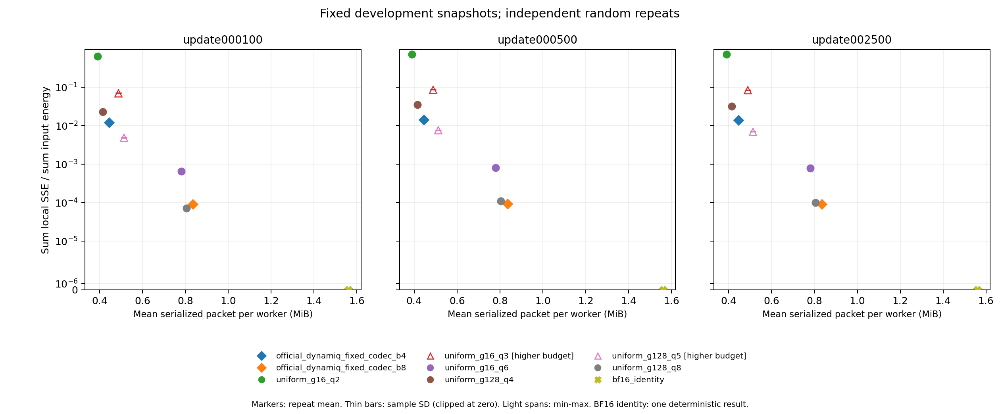
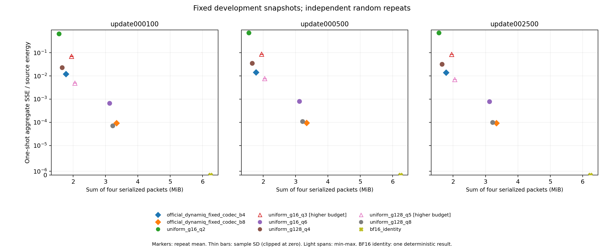

# 低比特梯度通信诊断报告

状态：已执行、完整交付。run_id：bounded_discovery_v1_20261104_001；日期：2026-11-04。完成 **D0 + D1**；单因素定位 0 项，D2 未执行。

## 1 结论和下一步

**decision = no_actionable_signal。** 有效完成既定有限比较；低精度存在实际字节与误差取舍，高精度均匀参照只在update100占优、另两快照反转，尚无具体触发机制与可行动干预证据；本次有限诊断未找到可推进线索。

官方固定 codec 资格通过；最终修订完成 3 个开发快照、每快照 4 个 worker、9 个配置、8 次随机重复（BF16 identity 1 次）。780 条局部记录及 195 条 one_shot_codec_sum 记录全部有效，无失败或缺失。独立复算确认原始数值与保存的 BF16 输出相符。

本轮没有达到计划五项条件的问题线索，不追加新数据或干预来寻找正结果，也不编写 D2 确认方案。结论只适用于这条小型 Transformer 训练轨迹的固定组件诊断，不能推出不存在独立贡献，也不能否定完整 DynamiQ 的动态配置、通信协议或训练效果。

## 2 官方基线资格

仓库：https://github.com/CharlesHan24/DynamiQ；commit `96da2ee480bbfd8e2049de3fbd8595cc9d7a30b8`。实际入口 `eden_utils.scaling_compress/scaling_decompress`，固定 BF16、strategy=3、chunk=16，主码实际存储 4/8 位。它与 G1 本地 5/9 位 profile 有不同语义和预算，本轮未把本地实现更名为官方。

构建二进制 SHA256：`d4eaf1d9a23930d34a6edb5b54254913679ac854bd855124c13b40e2c5f38880`。a01 被 GBK 读源码阻断；a02 在 UTF-8 与移除两个未用 POSIX include 后遇到 cuRAND 头缺失；a03 加入项目隔离的 NVIDIA cuRAND 10.3.0.86 头文件后成功。正好两轮修复，官方 `--use_fast_math`、尺度/主码/舍入/输出算术未改。原始源码、许可证、diff、失败日志均保留。共享 PyTorch、驱动及旧封存环境未升级。

原官方 48 配置功能自测通过，保留原容差；7 类输入×2 档共 14 组小型检查、新进程仅包+静态配置解码、CPU 独立逐字节拆包/repack 均通过。uniform 合成检查最终 205 项通过；a01 的 18 个空张量哈希测试框架失败及修复均保留。详见 [资格核验](baseline_qualification.json)、[独立源码核验](logs/official_contract_review.json)、[问题记录](issues.jsonl)。

解码静态状态包含 dtype、位宽、逻辑/补齐长度、chunk/strategy 及源码生成 LUT。官方 9,288 B 是源码定义的设备表数据量，单列且非每包传输；它不是 allocator 实测或总显存。编码端随机池为临时本地状态，不用于解码。极值检查只证明已测样例；合法 BF16 RNG 可能取到 1，全零端点探针的约 1e-7 输出符合官方参考，未伪装成“全零必精确”或全域无偏证明。

## 3 冻结比较条件

仅使用 seed=1101、update=100/500/2500 的已验收 development 输入，共 12 份。来源及文件/逻辑张量 SHA256 见 [input_manifest](input_manifest.json)。读取 `input_logical`：原始 FP32→BF16→BF16 除以4 的结果，D=818048，不再次预除，不把旧尾部当成输入。官方 P=818176；本轮 uniform 的 D 可整除 g，无新增尾部。所有最终输出为 BF16，指标只算逻辑部分。

最终契约 revision=2，SHA256 `97e8595532125d1fed44956c6a70da959031581884e753b449b64c1b3b195f47`。修订只补足失败反例保存和完整结束判定，保留 [v1 全部证据](revisions/contract_v1)。9 个配置、输入、预算和 seed 映射与 v1 完全相同；重跑的实际包、BF16 输出及误差已逐项核对。没有观察误差后重新选择预算。

预算先由实际编码字节确定：C_low=466616、C_high=875704 B/worker。uniform q 为实际码宽，FP32 scale 使用 FP64 覆盖检查与 nextafter 修正，FP32 归一化/概率及乘法后 BF16 RNE；16 B 真实头部计入预算。below/above 预算关系不等于等预算比较，所有 alignment/per-input auxiliary=0。

| 方法 | 实际码宽 | P | payload B | scale B | header B | 总 B/worker | 相对位置 |
|---|---:|---:|---:|---:|---:|---:|---|
| official_dynamiq_fixed_codec_b4 | 4 | 818176 | 409088 | 57528 | 0 | 466616 | low_official |
| official_dynamiq_fixed_codec_b8 | 8 | 818176 | 818176 | 57528 | 0 | 875704 | high_official |
| uniform_g16_q2 | 2 | 818048 | 204512 | 204512 | 16 | 409040 | low_lower_budget |
| uniform_g16_q3 | 3 | 818048 | 306768 | 204512 | 16 | 511296 | low_higher_budget |
| uniform_g16_q6 | 6 | 818048 | 613536 | 204512 | 16 | 818064 | high_lower_budget |
| uniform_g128_q4 | 4 | 818048 | 409024 | 25564 | 16 | 434604 | low_lower_budget |
| uniform_g128_q5 | 5 | 818048 | 511280 | 25564 | 16 | 536860 | low_higher_budget |
| uniform_g128_q8 | 8 | 818048 | 818048 | 25564 | 16 | 843628 | high_lower_budget |
| bf16_identity | 16 | 818048 | 1636096 | 0 | 0 | 1636096 | uncompressed_reference |

随机 seed = SHA256(`bounded_discovery_v1:input_id:method_id:repeat_id`) 前8字节小端 mod 2^63。768 个随机任务均为独立构造且 seed 无重复。官方沿原自测 CPU FP32 rand→BF16→CUDA 路径；uniform 使用 CPU FP32 U∈[0,1)。按输入配对，不声称跨方法 matched randomness，不把 PRNG 重复当作独立训练轨迹。

## 4 数值和字节结果

以下为均值 ± sample std；确定性 std=null。局部每次先汇总四 worker SSE 和 energy 再求比，未平均四份相对误差。one-shot 用同四份解码结果与输入分别在 FP64 求和，不追加量化调用。其字节为表中 B/worker 的4倍，字段 `one_shot_packet_bytes_sum`，不是网络总流量或 ring AllReduce。

### seed1101_update000100

| 方法 | B/worker | 局部 ΣSSE/Σenergy | one-shot SSE/source_energy |
|---|---:|---:|---:|
| official_dynamiq_fixed_codec_b4 | 466616 | 0.0122097 ± 0.000156356 | 0.0122371 ± 0.000498128 |
| official_dynamiq_fixed_codec_b8 | 875704 | 9.10697e-05 ± 9.28699e-07 | 9.21612e-05 ± 3.15257e-06 |
| uniform_g16_q2 | 409040 | 0.645933 ± 0.00728433 | 0.652543 ± 0.0208593 |
| uniform_g16_q3 | 511296 | 0.0704444 ± 0.000822146 | 0.0705804 ± 0.00170589 |
| uniform_g16_q6 | 818064 | 0.000658059 ± 1.02996e-05 | 0.000661271 ± 1.74519e-05 |
| uniform_g128_q4 | 434604 | 0.0227577 ± 0.000245203 | 0.0228586 ± 0.000388209 |
| uniform_g128_q5 | 536860 | 0.00491897 ± 6.85907e-05 | 0.00494323 ± 7.81549e-05 |
| uniform_g128_q8 | 843628 | 7.11708e-05 ± 7.15121e-07 | 7.1591e-05 ± 1.44603e-06 |
| bf16_identity | 1636096 | 0（确定性） | 0（确定性） |

### seed1101_update000500

| 方法 | B/worker | 局部 ΣSSE/Σenergy | one-shot SSE/source_energy |
|---|---:|---:|---:|
| official_dynamiq_fixed_codec_b4 | 466616 | 0.0141689 ± 2.81581e-05 | 0.0142396 ± 8.39618e-05 |
| official_dynamiq_fixed_codec_b8 | 875704 | 9.36755e-05 ± 3.95851e-07 | 9.38689e-05 ± 4.5036e-07 |
| uniform_g16_q2 | 409040 | 0.72753 ± 0.00223228 | 0.730149 ± 0.00388752 |
| uniform_g16_q3 | 511296 | 0.0863091 ± 0.00020726 | 0.0865149 ± 0.000746997 |
| uniform_g16_q6 | 818064 | 0.000809983 ± 2.85633e-06 | 0.000809159 ± 3.18128e-06 |
| uniform_g128_q4 | 434604 | 0.0351466 ± 8.12849e-05 | 0.0350508 ± 0.000249058 |
| uniform_g128_q5 | 536860 | 0.0076522 ± 1.98541e-05 | 0.00764368 ± 4.51494e-05 |
| uniform_g128_q8 | 843628 | 0.00010944 ± 4.81672e-07 | 0.000109584 ± 5.77829e-07 |
| bf16_identity | 1636096 | 0（确定性） | 0（确定性） |

### seed1101_update002500

| 方法 | B/worker | 局部 ΣSSE/Σenergy | one-shot SSE/source_energy |
|---|---:|---:|---:|
| official_dynamiq_fixed_codec_b4 | 466616 | 0.0139567 ± 2.85214e-05 | 0.0139802 ± 7.59749e-05 |
| official_dynamiq_fixed_codec_b8 | 875704 | 9.1953e-05 ± 2.91057e-07 | 9.195e-05 ± 3.47827e-07 |
| uniform_g16_q2 | 409040 | 0.726789 ± 0.00157376 | 0.726266 ± 0.00244298 |
| uniform_g16_q3 | 511296 | 0.0846728 ± 0.00020581 | 0.0849321 ± 0.000447245 |
| uniform_g16_q6 | 818064 | 0.000794049 ± 1.55857e-06 | 0.000794887 ± 4.36329e-06 |
| uniform_g128_q4 | 434604 | 0.0322326 ± 5.55885e-05 | 0.0322374 ± 0.000115763 |
| uniform_g128_q5 | 536860 | 0.00703007 ± 1.18902e-05 | 0.00703455 ± 3.94004e-05 |
| uniform_g128_q8 | 843628 | 0.000100156 ± 2.55116e-07 | 0.000100018 ± 5.20054e-07 |
| bf16_identity | 1636096 | 0（确定性） | 0（确定性） |

### 输入能量与绝对误差

| 快照 | source_energy | target_energy | cancellation_ratio | official b4 aggregate SSE | b4 target_relative_error | b8 aggregate SSE | b8 target_relative_error |
|---|---:|---:|---:|---:|---:|---:|---:|
| seed1101_update000100 | 0.187864 | 0.46606 | 2.48084 | 0.00229892 ± 9.35804e-05 | 0.00493266 ± 0.00020079 | 1.73138e-05 ± 5.92254e-07 | 3.71492e-05 ± 1.27077e-06 |
| seed1101_update000500 | 0.40294 | 0.771643 | 1.91503 | 0.00573771 ± 3.38316e-05 | 0.0074357 ± 4.38435e-05 | 3.78235e-05 ± 1.81468e-07 | 4.90168e-05 ± 2.35171e-07 |
| seed1101_update002500 | 1.40075 | 1.50612 | 1.07522 | 0.0195828 ± 0.000106422 | 0.0130022 ± 7.06599e-05 | 0.000128799 ± 4.8722e-07 | 8.55174e-05 ± 3.23494e-07 |

三个 cancellation_ratio 均远大于1e-6，未触发 near_cancellation。cross_term 与全部 SSE/MSE/max_abs、逐重复 min/max 均在原始和汇总文件中；单次非零 cross_term 不解释为已证明相关噪声。BF16 identity 的 12 条局部及3条 one-shot SSE 严格为0，仅检验本次 FP64 量化诊断，不意味着 BF16 网络归约无加法舍入。

[每输入完整表](PER_INPUT_RESULTS.md)覆盖108个输入×方法分布，含离散与 min/max；[机器汇总](metrics_summary.jsonl)含162组统计。稳定 raw 键：`record_type + snapshot_id + worker_id + method_id + repeat_id`，聚合 worker_id=null。每份包与解码结果可由 packet_id 定位 `packets/`、`decoded/`，并绑定契约/input_manifest 哈希。没有筛掉不利 worker 或重复。

性能测量：not_run。Python uniform 与官方 CUDA 的实现成熟度不同，未作速度竞赛、网络加速或完整系统吞吐结论。

## 5 问题线索和定位

筛查记录见 [decision_evidence](logs/decision_evidence.json)。没有选定主要发现，也未执行单因素对照。

1. 低位档：官方 b4 的三个局部归一化误差约0.01221/0.01417/0.01396；g128q4 下邻误差更大，g128q5 上邻误差更小但多付约15.05%字节。g16q3 则比官方 b4 包大且误差更大。这些显示位宽、组粒度与非均匀代表值的成本取舍，不是统一预算下的缺陷证据。
2. 高位档：g128q8 比官方 b8 少3.66%字节，局部误差比（uniform/官方）为 000100: 0.7815, 000500: 1.1683, 002500: 1.0892。update100 上它在所测均值上支配官方点，且所测8次重复方向一致、区间不重叠，已超过本轮观察到的重复离散范围；但另两快照误差反转，one-shot 方向一致。本轮没有给出update100特有的可复现特征触发条件、出现范围、算术归因及带成本干预。分布适配和尺度粒度仍是未排除的解释，未声称已证明机制；这个实际点优势未自动升级为问题线索。
3. RNG=1 的零端点是 D0 中记录的官方有限精度边界，原参考亦如此。本轮未隔离其在真实梯度上的实际效应，不能把这个玩具端点或论文与代码表述差异写成已成立的研究线索。

判断为 no_actionable_signal：未形成满足计划§6五项条件的具体候选，也未进入有待解决的机制定位；跨快照点优势只作为描述性筛查记录，未据此主张某个待确认机制。规定的比较覆盖、正确性和字节账本均已有效完成，不存在未修复的比较缺口。该结论不声称已解释或排除所有微观误差机制。

## 6 最接近工作与贡献判断

检查了 [DynamiQ 原论文 arXiv v3](https://arxiv.org/pdf/2602.08923v3)：p5 §3.3 介绍非均匀代表值及层次量化，p6 §3.5 给出系统预算，p11 Table6已有组件消融。论文层次尺度的随机量化论述与本次冻结 CUDA 的确定性 ceil 尺度路径不是同一算术契约；其理论无偏论证未直接套用于本实现。ACM正式版页面未能读取，采用已核实的作者 v3，并明确这一限制。

[官方量化说明](https://github.com/CharlesHan24/DynamiQ/blob/96da2ee480bbfd8e2049de3fbd8595cc9d7a30b8/cuda_kernels/documentation/scaling_quantization_algorithm.md)与[固定 CUDA 源码](https://github.com/CharlesHan24/DynamiQ/blob/96da2ee480bbfd8e2049de3fbd8595cc9d7a30b8/cuda_kernels/src/srrcomp/eden_utils/csrc/cuda_hierarchical_mee.cu)用于核对实际尺度重建与码值路径。公开分支/commit/issue/PR 检查未发现冻结版本之后的公开 codec 修复；不声称覆盖未公开信息。具体位置与访问限制见 [原文定位](logs/nearest_work_source_review.json)。

本次新增的是可达的官方局部组件、真实字节邻点与可复算开发数据证据；它们属于复现和诊断交付，尚不是独立算法贡献。完整系统的动态位宽、前置统计、跨 worker 相关协议、多跳通信与训练质量均未在本轮验证。

## 7 执行成本和交付完整性

D0 主动工作保守上界 0.3293 h（整个阶段墙钟），构建修复2轮。D1 至交付准备结束的工作窗口上界 0.6667 h，从本轮任务开始计入以覆盖与D0重叠的准备，包含两次完整执行及独立复核；不是多个并行代理工时之和。最终执行墙钟 178.608 s，最终 CUDA 操作窗口 3.035 s；两次 D1 窗口均已计入累计额度。把整个 D0 墙钟也全部计入后的 GPU 保守上界 1192.047 s（0.3311 h），低于2h。该上界包含 CPU/build 等非GPU时间，不冒充精确kernel执行时间。

独立汇总/复算通过 55403 项检查，重新读取12份逻辑输入、780份解码输出并复算195份聚合；3125条最终正确性记录均通过。跨修订审计见 [revision_equivalence_audit](logs/revision_equivalence_audit.json)；两次为同种子复现，不累计成16次独立重复。源代码与所加载二进制由 source_manifest 绑定，报告程序等后处理源另列 delivery_sources.json；其加入不改变冻结的实验算术或指标。

交付保留两次完整执行、实际包与解码结果、官方小型反例/边界样例、构建失败与修复日志，以及严格JSON。原始官方源码与许可证已保留；没有复制旧G1/G2a整包、环境或模型。使用完整结果目录交付，未另生成ZIP。最终 [integrity_manifest](integrity_manifest.json)覆盖目录文件（排除自身），外部封存回执记录清单哈希。复算与历史执行入口见 [REPRODUCE](REPRODUCE.md)。

本轮在此结束。D2、新训练、新数据采集、G2b–G4及旧候选均未执行。
