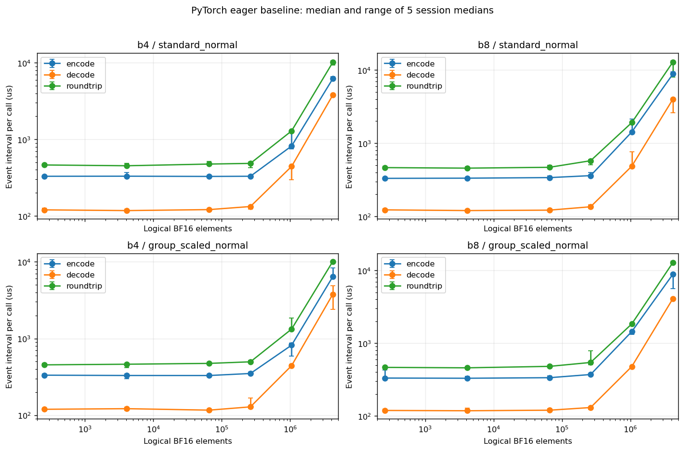
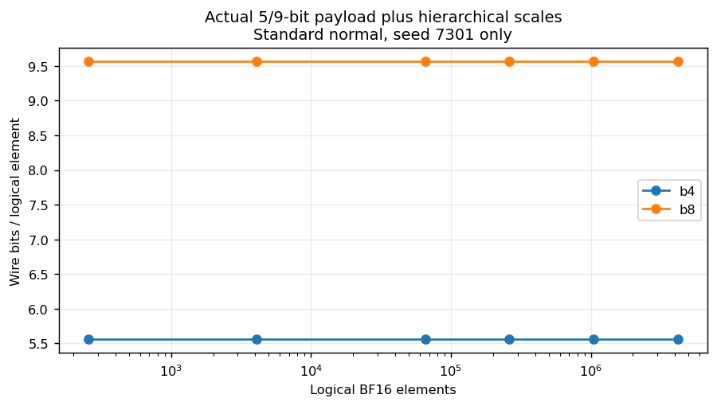
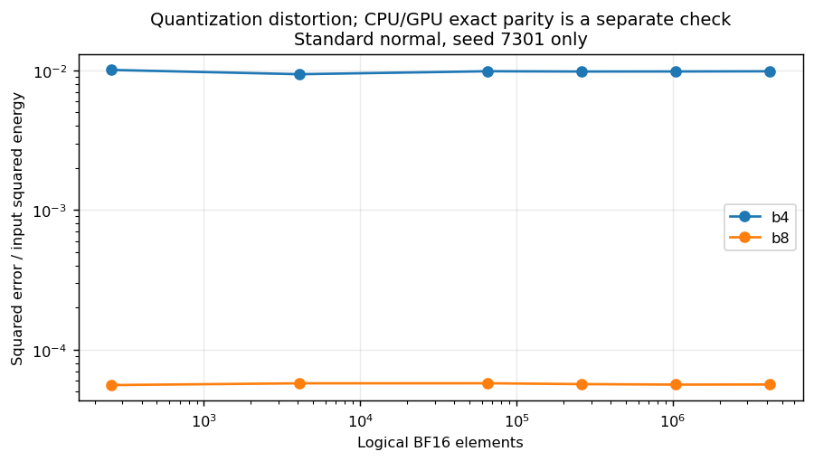
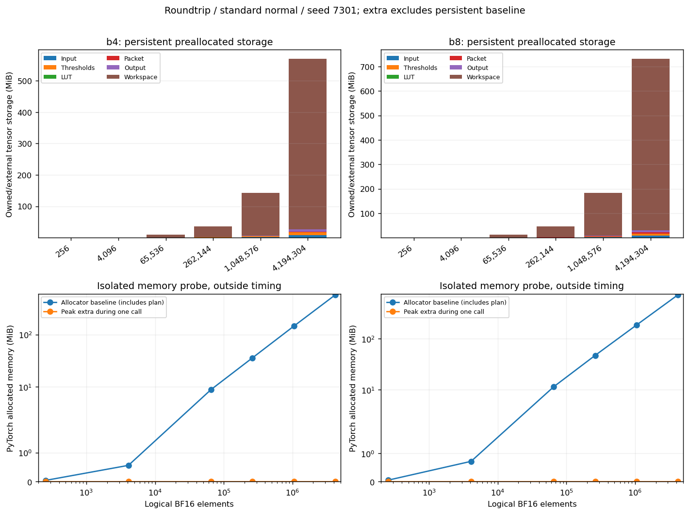

# GPU 低比特编解码实施报告

run_id：`gpu_codec_v1_20261101_002`。生成时间：2026-11-01T23:10:22.162217+08:00。技术方案版本：1.0；复核依据：`reviews/gpu_codec_v1_20261101_001_review.md`。

## 1 结论与完成范围

已完成 G1a 的纯 PyTorch CUDA eager 局部 codec 基线。正式正确性 **1101项通过、0失败、0跳过**，其中GPU检查937项、CPU参照实际roundtrip164项；两者的码值、尺度、紧凑码流和BF16输出一致。104个基线性能case完成5个session、每session20个计时块，汇总校验通过。标准正态seed7301的N=4,194,304直接roundtrip中位延迟为b4 **10,147.397 us**、b8 **12,868.778 us**。本次没有优化版codec，也没有配对加速比，因此完整G1及其顶层执行/正确性/性能验收状态均为`incomplete`。

| 项目 | 实际状态 | 证据路径 |
|---|---|---|
| 环境与最小CUDA扩展 | NVIDIA RTX 4000 Ada Generation；编译 pass / GPU调用 pass | environment.json；logs/toolchain_summary.json |
| b=4 固定配置 | CPU/GPU完整包、整数码、尺度和BF16输出逐位通过 | correctness.jsonl |
| b=8 固定配置 | 完整合法码集合与修复索引逐位通过 | correctness.jsonl |
| 真实梯度 | 12输入×2位宽局部codec通过；无新训练结果 | input_manifest.json；logs/correctness_analysis.json |
| GPU性能与显存 | PyTorch子矩阵valid：104case、10400块、520显存记录 | analysis.json；benchmark_raw.jsonl；memory.jsonl |
| 完整G1验收 | incomplete：缺cuda_optimized_repaired及配对比较 | summary.json |

## 2 实现与契约

沿用已接受G0的CPU参照及上游commit `96da2ee480bbfd8e2049de3fbd8595cc9d7a30b8`，没有改动旧项目或旧run。CPU核心 `dynamiq.py` SHA256为 `9296231d3a29d3fb4cfa1d12a2ffe5a1a4d2922e62c51003fb214c59303e8ea0`；GPU实现 `src/gradient_comm_lab/torch_codec.py` SHA256为 `50bc272876be54db5d42327cce144022b7bf960d82073347479da2eb53f1d794`。本次契约SHA256为 `068400a4067849390aec27a01d9f46811e395f0765f63ccb67fdeda82e470e7d`，9个执行源文件在正式验收前冻结，正式检查与计时均核验注册哈希。

输入/输出是连续一维BF16；逻辑长度向上补齐到256，尾部补零，解码裁切回原长。空输入跳过量化、零字节包。名义b4/b8实际载荷为5/9位，低位先行；16元素一组的uint8尺度码和256元素一组的BF16顶层尺度紧随payload，额外header/alignment为0。完整包大小是`ceil(L*(b+1)/8)+L/16+2*L/256`。LUT与显式CPU阈值均有原始字节哈希；阈值按固定CPU生成器先main后scale生成，codec内不推进LCG。

各步保留BF16舍入，包括`BF16(1e-23)`、`BF16(65535)=65536`、`qscale_BF16*top/255`；查表用`right=True`，阈值比较严格`<`，b8查表偏移在整数域完成，负零保留。`qscale=0`合法；checked API拒绝非有限输入/中间量/输出、非法码流与尺度。trusted路径保留形状/dtype/device等主机元数据检查，不读取GPU值；其输入已经CPU和checked GPU验收。checked路径包含显式GPU谓词同步，单独计时。外部输入/阈值/LUT不能别名到plan-owned storage。

GPU基线使用已安装PyTorch 2.4.1+cu118 的CUDA 11.8 二进制算子，没有编译自定义codec；CUDA Graph关闭、compile=eager、无快速数学替换。环境为Windows-10-10.0.26200-SP0，GPU为NVIDIA RTX 4000 Ada Generation，驱动596.72。复核允许把原先的编译依赖拆开，先交PyTorch基线；这一调整没有降低数值与计时验收标准。工具链状态见第6节，最小扩展通过也不代表优化codec已经存在。

## 3 正确性结果

82个输入由36个合成、34个边界、12个原样复用真实梯度构成。合成覆盖6个性能长度、标准正态/组间尺度不同正态、种子7301/7302/7303，先CPU FP32生成再转BF16。边界覆盖外层长度0/1/15/16/255/256/257/1023/1024/1025，全零、正负常数、负零、subnormal、尺度差异、LUT端点/中点/相邻可表示数和阈值0/65536。

每个输入×位宽执行编码、独立解码、roundtrip、重复性和输入保护五类GPU检查；输入、两类阈值和LUT在操作前保存独立CPU字节快照，输出和重复码流也使用独立副本。117条补充协议检查包括10条pack、39条decode、4条encode算术探针、4条精确归一化LUT边界roundtrip和60条预期拒绝。涵盖b4/b8全部合法码、截断/unused/尾部填充位、65,280个有限BF16 epsilon复算、最小subnormal顶层尺度、qscale0/1/127/255以及内部与最终输出溢出。五类差异累计全部为0。

真实梯度来自seed1101、更新前100/500/2500、rank0–3的12份开发夹具，保持原始来源与阈值身份；使用`x=(g_i.to(BF16)/4)`后再补齐，没有重新训练、反向传播或打开留出分区。量化失真用FP64累积且排除padding，量化误差与实现差异分开。12个真实输入结果为：

| b | 输入数 | 完整包 | 解码 | MSE范围 | 归一化SSE范围 | wire B | 实际bits/逻辑元素 |
|---|---|---|---|---|---|---|---|
| 4 | 12 | 0 字节差异 | 0 BF16 位差异 | 4.14418e-10–4.95066e-09 | 0.00910953–0.0107707 | 568888 | 5.563370 |
| 8 | 12 | 0 字节差异 | 0 BF16 位差异 | 2.53024e-12–2.7774e-11 | 5.45335e-05–5.9975e-05 | 977976 | 9.563996 |

所有164对CPU/GPU量化指标逐字段相等。零长度的每元素指标和零能量的归一化指标使用`null`并注明原因。正式检查没有反例；早期pytest曾有18个测试助手TypeError，修复字节展平后38项通过，旧JUnit与归因文件保留。早期smoke与两次完整preliminary日志标记`preliminary_not_formal`，不替代正式契约证据。

## 4 GPU 性能结果

主矩阵为6长度×2分布×2位宽×encode/decode/roundtrip=72case；另有标准正态N=65,536/1,048,576的8个allocating API case和24个真实梯度roundtrip case，共104。每case warmup至少50次；5个session分别用固定种子7501–7505打乱case顺序，每case每session20块。独立pilot以3次单调用中位数选择接近20ms的K，固定范围为3–490，正式计时后不更改。全部10,400块保留。

CUDA Event记录的是stream区间，包含eager发射空隙以及checked/API路径中的同步或分配空隙；不是单纯kernel执行时长之和。wall计时边界为预同步之后开始，包含event、K次调用和末尾event同步。主矩阵复用预分配plan；所有case的外部输入、LUT和阈值生成/文件读取/H2D、CPU参照与正确性检查在计时外。allocating API每次创建整个plan/index/workspace及3个BF16标量常数，这部分初始化及可能的CPU→GPU常量拷贝/同步包含在被测factory成本中。Graph关闭、eager执行、steady-state reuse；确定性算法开启、未初始化内存填充关闭。roundtrip来自直接测量，没有把encode和decode相加代替。

测量运行在Windows WDDM工作站，不能声称独占或空载：`logs/benchmark_external_processes_before.json`保留测量前桌面/GPU进程快照，部分进程显存为N/A或因权限不能读取；`logs/benchmark_device_states.jsonl`保留会话边界设备状态。没有把观察到的噪声归因于某个具体应用，也没有把瞬时环境快照当作整个实验的恒定负载。

下表为标准正态seed7301；中位数是5个session中位数的中位数，范围是这5个中位数的最小–最大。优化版与加速比均为`null`，不能据此判定任何大小上的优化收益。

| b | 逻辑N | 操作 | PyTorch中位us | 优化版us | session中位范围us | 配对加速比 | 噪声标记 |
|---|---|---|---|---|---|---|---|
| 4 | 256 | roundtrip | 463.155 | null | 445.338–482.656 | null | 是 |
| 8 | 256 | roundtrip | 464.398 | null | 440.327–483.012 | null | 是 |
| 4 | 65,536 | roundtrip | 476.021 | null | 472.904–516.079 | null | 是 |
| 8 | 65,536 | roundtrip | 468.930 | null | 460.505–500.701 | null | 是 |
| 4 | 1,048,576 | roundtrip | 1,289.287 | null | 1,240.217–1,313.501 | null | 是 |
| 8 | 1,048,576 | roundtrip | 1,909.730 | null | 1,871.667–1,971.644 | null | 是 |
| 4 | 4,194,304 | roundtrip | 10,147.397 | null | 9,287.930–10,639.584 | null | 否 |
| 8 | 4,194,304 | roundtrip | 12,868.778 | null | 7,934.139–13,346.304 | null | 否 |
| 4 | 4,194,304 | encode | 6,194.416 | null | 5,998.251–6,578.773 | null | 否 |
| 4 | 4,194,304 | decode | 3,786.496 | null | 3,691.272–3,854.400 | null | 否 |
| 8 | 4,194,304 | encode | 8,817.536 | null | 8,741.248–9,440.768 | null | 否 |
| 8 | 4,194,304 | decode | 3,999.517 | null | 2,591.177–4,087.650 | null | 否 |

`noise_flag`只检查session内的IQR/median，无标记不代表跨session稳定。例如N=4,194,304的b8 roundtrip未触发该标记，但5个session中位数仍分布在7.934–13.346ms，必须连同范围解读中位数。

API调用每次构造完整plan/workspace后执行roundtrip，因此同时包含分配和索引/常量准备；checked模式额外包含验证同步。其独立结果为：

| N | b | 验证模式 | allocating中位us | session中位范围us |
|---|---|---|---|---|
| 65536 | 4 | trusted_inputs | 1,207.735 | 934.674–1,518.351 |
| 65536 | 4 | checked_api | 4,727.728 | 4,534.855–4,811.959 |
| 65536 | 8 | trusted_inputs | 1,219.125 | 1,204.846–1,282.286 |
| 65536 | 8 | checked_api | 4,689.035 | 4,388.137–4,858.667 |
| 1048576 | 4 | trusted_inputs | 2,071.712 | 1,974.208–2,152.034 |
| 1048576 | 4 | checked_api | 6,207.437 | 6,120.755–6,245.933 |
| 1048576 | 8 | trusted_inputs | 2,920.588 | 2,833.734–3,659.171 |
| 1048576 | 8 | checked_api | 6,917.469 | 6,759.286–7,125.376 |

**噪声和目标时长诊断不作剔除：**67/104个case出现至少一个session的GPU IQR/median>0.10，共140/520个case-session；低于10ms目标的块6个，高于50ms的块765个，共771/10,400。实际块时长min/median/max为8.578/31.129/84.521ms。详单、每session统计和原始观测均保留在`analysis.json`、`benchmark_summary.jsonl`和`benchmark_raw.jsonl`。p95描述的是块平均每调用延迟，不能解释为单次请求尾延迟。

## 5 字节、显存与性能剖析

可手算示例：N=L=256时，b4 payload=160B、uint8尺度=16B、BF16顶层尺度=2B，完整包178B，即5.5625bits/元素；b8分别为288+16+2=306B，即9.5625bits/元素。真实梯度的实际bits/逻辑元素略高，因为最后一块padding也占wire空间。wire大小不等于GPU临时存储。

下表按独立显存探针跨5个session的中位数列出标准正态预分配roundtrip的张量存储，单位MiB；按唯一storage计数，不重复计算view。

| N | b | 输入 | 阈值 | LUT | 包 | 输出 | workspace |
|---|---|---|---|---|---|---|---|
| 65536 | 4 | 0.1250 | 0.1328 | 0.0001 | 0.0435 | 0.1250 | 8.4805 |
| 65536 | 8 | 0.1250 | 0.1328 | 0.0010 | 0.0747 | 0.1250 | 10.9805 |
| 4194304 | 4 | 8.0000 | 8.5000 | 0.0001 | 2.7812 | 8.0000 | 542.7500 |
| 4194304 | 8 | 8.0000 | 8.5000 | 0.0010 | 4.7812 | 8.0000 | 702.7500 |

分配器基线已经包含输入、阈值、LUT及整个持久plan；下表基线为session中位数，peak/extra取session最大值。`extra=peak_allocated-allocated_before`，extra为零不等于工作内存为零。reserved是PyTorch缓存分配器保留空间，不能当作wire或纯codec张量大小。

| N | b | allocated基线MiB | peak allocated MiB | peak extra MiB | reserved基线MiB | peak reserved MiB |
|---|---|---|---|---|---|---|
| 65536 | 4 | 8.9097 | 8.9097 | 0.0000 | 10.0000 | 10.0000 |
| 65536 | 8 | 11.4419 | 11.4419 | 0.0000 | 14.0000 | 14.0000 |
| 4194304 | 4 | 570.0342 | 570.0342 | 0.0000 | 610.0000 | 610.0000 |
| 4194304 | 8 | 732.0352 | 732.0352 | 0.0000 | 766.0000 | 766.0000 |

allocating API的baseline仍有一份用于参照的持久plan，每调用再建立一份新plan，其增量单独记录于`memory.jsonl`。这些统计只覆盖PyTorch allocator，不包括CUDA context/driver的外部分配。显存探针在正式计时之外执行。

独立GPU活动trace为`traces/cupti_roundtrip_b4_n65536_a03.json`，成功清单是`traces/gpu_activity_manifest.json`，对应b4/N=65,536的3次可信输入预分配roundtrip。CUPTI12.9仅用作分析组件，应用与正式基线仍使用PyTorch cu118。共156个kernel，平均52.0个/次；无法关联到操作的kernel为0。设备memcpy事件6，runtime memcpy调用6，设备memset事件0，runtime同步事件1。trace边界包含末尾显式同步，不能把该同步计作codec内部验证，也不能以trace时长替换正式样本。这份trace只覆盖preallocated模式，不能据此声称allocating API没有host copy。主要kernel按累计设备时长排序：

| kernel | 次数 | 累计us | 平均us |
|---|---|---|---|
| _ZN2at6native44_GLOBAL__N__6f92ad62_11_Indexing_cu_2a2c434e21indexSelectLargeIndexIxxjLi1ELi1ELin2ELb1EEEvNS_4cuda6detail10TensorInfoIT_T1_EENS5_IKS6_S7_EENS5_IKT0_S7_EEiiS7_S7_x | 15 | 36.832 | 2.455 |
| _ZN2at6native18elementwise_kernelILi128ELi4EZNS0_22gpu_kernel_impl_nocastINS0_13BinaryFunctorIN3c108BFloat16ES5_S5_NS0_15binary_internal10MulFunctorIfEEEEEEvRNS_18TensorIteratorBaseERKT_EUliE_EEviT1_ | 15 | 29.792 | 1.986 |
| _ZN2at6native18elementwise_kernelILi128ELi4EZNS0_22gpu_kernel_impl_nocastINS0_13BinaryFunctorIN3c108BFloat16ES5_S5_NS0_15binary_internal10DivFunctorIS5_EEEEEEvRNS_18TensorIteratorBaseERKT_EUliE_EEviT1_ | 12 | 25.152 | 2.096 |
| _ZN2at6native24index_elementwise_kernelILi128ELi4EZNS0_20cuda_take_put_kernelIN3c108BFloat16EiZZZZZNS0_11take_kernelERNS_14TensorIteratorERKNS_10TensorBaseEENKUlvE_clEvENKUlvE10_clEvENKUlvE_clEvENKUlvE_clEvEUlRS4_iE_EEvS6_S9_RKT1_EUliE_EEvxSG_ | 9 | 24.000 | 2.667 |
| _ZN2at6native29vectorized_elementwise_kernelILi4ENS0_21CUDAFunctorOnSelf_addIxEENS_6detail5ArrayIPcLi2EEEEEviT0_T1_ | 15 | 22.656 | 1.510 |

采集覆盖已核验：raw窗口内记录与Chrome trace逐项相等，dropped records和采集错误均为0。方向审计记录DtoD 6次、合计1,966,080B，HtoD 0次、DtoH 0次。这里的0有已启用活动类型、关联/时间窗完整性和零丢记录支撑，结论只限这3次preallocated roundtrip的捕获窗口；不覆盖准备阶段或allocating API。审计证据为`logs/cupti_trace_audit_a03.json`。

trace支持的下一步是减少当前多算子链的kernel发射与中间workspace：优先尝试融合16元素scale/归一化、LUT区间与显式随机舍入，并把紧凑打包接入同一实现。现有结果只证明该开销存在，融合收益需要新run逐位验收和配对测量，不能预填速度提升。

首次Windows PyTorch Kineto trace只有CPU事件，原始文件与`traces/manifest.json`仍保留；其中GPU kernel/copy/sync计数应为unknown/null，不是0。首轮分析误判valid的快照及纠正后的trace-incomplete快照也保留在`logs/analysis_attempt01_cpu_only_trace_misclassification.json`与`logs/analysis_attempt02_trace_incomplete.json`。CUPTI11.8探针失败也保留，成功证据来自另行采集的CUPTI12.9活动及raw→Chrome覆盖审计；没有用CPU算子数量替代GPU kernel数量。

## 6 未解决问题与下一步

工具链最终状态：`pass`；最小扩展编译=`pass`，GPU调用=`pass`。实际工具为nvcc 11.8.89、cl 19.38.33145、link 14.38.33145.0、Windows SDK 10.0.26100.0。最小GPU调用使用256元素验证y==x+1。项目独立的CUDA/MSVC准备没有改动旧run或原CPU实现；具体编译命令、日志与实际环境见`logs/toolchain_summary.json`和`environment.json`。下表a04的`compiled_loaded_gpu_not_run`是编译阶段快照，后续单独GPU调用已通过，以最终`gpu_call.status`为准。所有尝试保留：

供应记录存在明确边界：取得的官方VS catalog与channel宣告的大小/哈希不一致，未将catalog本身声称为哈希验证通过。单个MSVC包的SHA256及关键已签名MSVC二进制的签名检查通过；NVIDIA CUDA11.8组件按官方MD5核对并记录本地SHA256，`nvcc`的unsigned状态如实保留。详情见[工具链来源与校验记录](logs/toolchain_summary.json)。这些记录不改变上面的实际编译与GPU调用结果。

| 尝试 | 状态 | 原因 | 证据 |
|---|---|---|---|
| a01 | failed | Preflight stopped before source compilation: Desktop CRT package lacked /MD import library msvcrt.lib; added same-toolset CRT.x64.Store package. | logs\toolchain_compile_a01.json, logs/toolchain_compile_a01.log |
| a02 | failed | C++ translation unit compiled with cl 19.38; nvcc host discovery failed with Host compiler targets unsupported OS before CUDA source compilation. | logs\toolchain_compile_a02.json, logs/toolchain_compile_a02.log |
| a03 | failed | Adding documented --use-local-env alone did not fix missing auxiliary VS directory layout; same nvcc host discovery failure. | logs\toolchain_compile_a03.json, logs/toolchain_compile_a03.log |
| a04 | compiled_loaded_gpu_not_run | Official VS 2022 auxiliary Utils/Core.x86 packages restored VC/Auxiliary/Build/vcvarsall.bat layout; complete extension compile/load then GPU output equality passed. | logs\toolchain_compile_a04.json, logs/toolchain_compile_a04.log |

| 问题 | 影响/状态 | 证据 | 建议处理 |
|---|---|---|---|
| G1A-MISSING-OPTIMIZED | 仅完成 torch_cuda_repaired；cuda_optimized_repaired 及两实现配对比较缺失。完整 G1 不能通过。 | codec_contract.json；analysis.json；benchmark_config.json | 新 run 实现融合 CUDA codec，复用固定语义和全部夹具，通过后执行完整双实现矩阵。 |
| G1A-PYTEST-HELPER-001 | 首次 pytest 18 项在测试助手 bytes_of 对二维阈值生成嵌套列表时 TypeError，未进入 codec 比较；仅将助手 uint8 视图展平后 38 项全通过。 | logs/pytest_torch_codec_attempt01.xml；logs/pytest_torch_codec_attempt01_failure_analysis.json；logs/pytest_torch_codec_attempt02.xml | 已修复测试助手；CPU参照、阈值、期望结果和容差未改。 |
| G1A-BENCH-NOISE | 67/104 个 case 至少一个 session 的 GPU IQR/median>0.10，共 140/520 个 case-session。所有观测保留，不按快慢剔除。 | analysis.json；benchmark_raw.jsonl；benchmark_summary.jsonl | 保留当前数据；后续优化比较采用相同环境与配对会话，必要时在新run调查背景负载和时钟。 |
| G1A-BLOCK-DURATION | 固定 K 后 771/10400 块不在10–50 ms目标内：低于目标 6，高于目标 765。全部原始块仍计入汇总。 | analysis.json；benchmark_config.json；logs/K_pilot.jsonl | 目标区间用于诊断，不事后调整K或挑选快块；后续run可改进独立pilot设计。 |
| G1A-TOOLCHAIN-ATTEMPTS | 工具链保留 3 个非通过尝试；最终编译=pass，GPU调用=pass。每次原因见 toolchain_summary attempts。 | logs/toolchain_summary.json；logs\toolchain_compile_a01.json；logs/toolchain_compile_a01.log | 最小扩展只证明工具链可用，不能替代优化 codec 的实现、验收和性能测量。 |
| G1A-PROFILER-CPU-ONLY | 首轮Windows PyTorch Kineto仅输出CPU事件，初版汇总错误地将缺失GPU活动视为0并判valid；复核后改成unknown/null与trace incomplete，保留错误汇总和CPU-only trace。CUPTI11.8连独立cudart活动探针也未完成采集；仅追加CUPTI12.9 profiling组件后取得真实GPU/runtime活动并通过raw覆盖审计。 | logs/analysis_attempt01_cpu_only_trace_misclassification.json；logs/analysis_attempt02_trace_incomplete.json；traces/manifest.json | 已修正分析器的GPU活动可用性与覆盖门槛；新采集不改Torch cu118、固定codec或原始10400个计时块。 |

建议下一动作：`optimize_codec`。工具链最小闭环已通过，可在新的run实现并验证优化codec；完成双实现一致性和配对性能之后再复核完整G1。本轮不自动进入G2，不新增训练或多GPU结论。

## 7 复现与结论边界

实际命令入口：[REPRODUCE.md](REPRODUCE.md)。完整结果目录：`E:/dacomp/research/gradient_comm_lab/results/gpu_codec_v1/gpu_codec_v1_20261101_002`。`fixtures_manifest.json`记录全部夹具路径、字节数与SHA256，`traces/gpu_activity_manifest.json`记录成功GPU活动、raw记录和采集/审计源码快照；旧`traces/manifest.json`仅对应保留的CPU-only尝试。真实梯度夹具仍引用本机已接受G0文件。跨机器复核需取得这些明确列出的历史夹具/checkpoint、CPU参照及其导入依赖，并改配解释器和绝对路径；也可在具有这些依赖的环境按生成器重建新夹具目录。本交付不宣称是脱离原数据的portable standalone包。生成脚本是`scripts/summarize_g1a.py`和`scripts/write_g1a_report.py`，图表均可从JSONL重建。

本轮证明固定配置局部codec在这台GPU、这个PyTorch/CUDA环境及显式阈值下的正确性与成本。它没有实现完整DynamiQ的动态控制、LCG状态推进、误差反馈或ring多跳过程；没有新的训练质量、多GPU网络吞吐或训练加速证据，也没有证明压缩小包等于端到端更快。完整G1保留`incomplete`，只将已测PyTorch子矩阵标为complete/pass/valid。

## 8 交付文件核对

- [x] summary、环境、契约和基准配置使用实际数据，template_only=false；整体和逐实现状态分开。
- [x] CPU参考、GPU执行源、配置、输入与夹具哈希已记录，正式源冻结后未改动。
- [x] 1101条正确性、10400条原始计时、104个汇总和520份显存记录相互对应。
- [x] 延迟、wire/量化失真、显存三组共4张图可由原始JSONL重新生成。
- [x] 源码、测试、依赖与实际命令可取得；旧pytest失败、工具链失败与preliminary记录保留。
- [x] 未完成优化codec、噪声、目标时长偏离和本机外部夹具依赖均明确记录。

完整文件SHA封存由最后的独立交付审计生成`artifact_integrity.json`；该封存不是新增性能或正确性实验。
