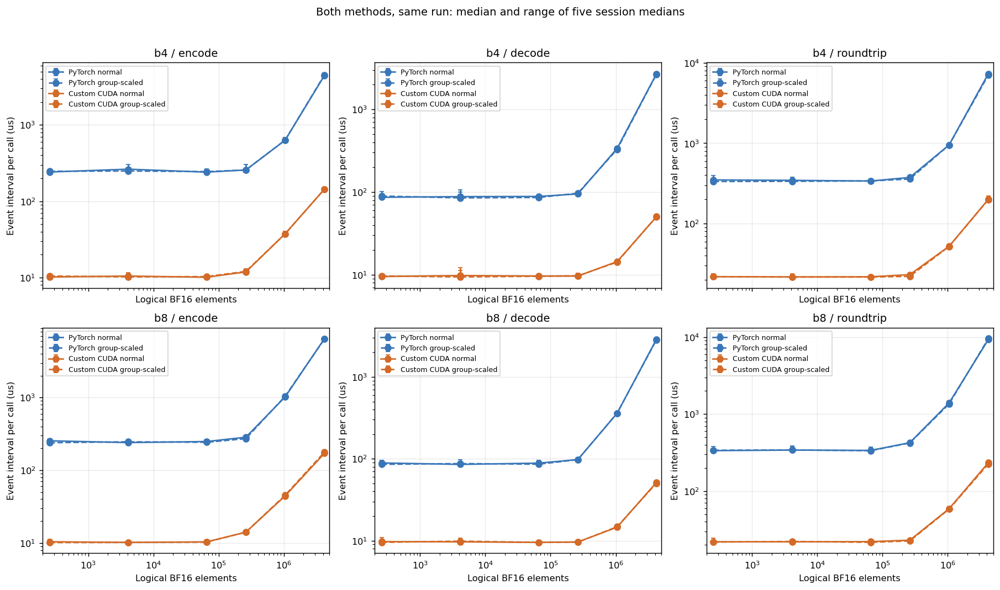
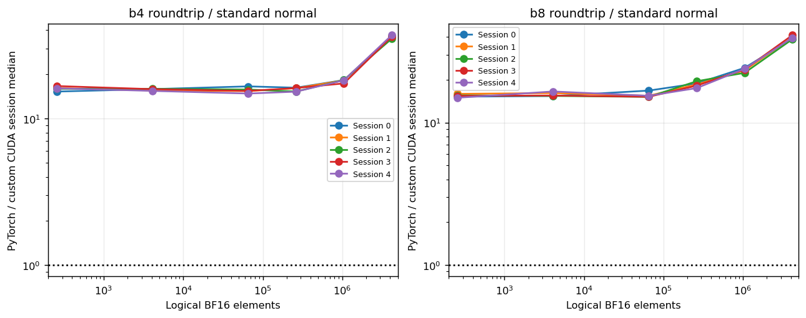
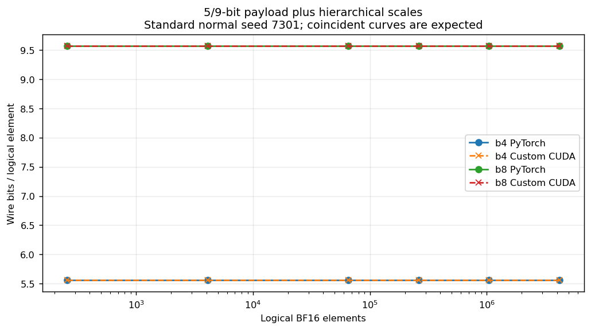
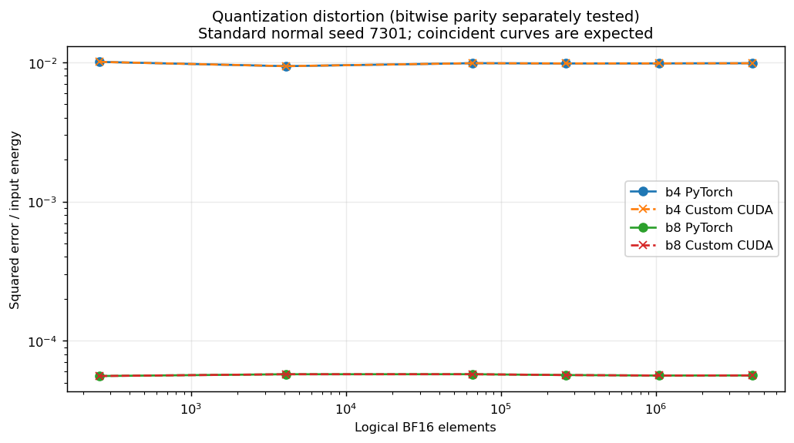
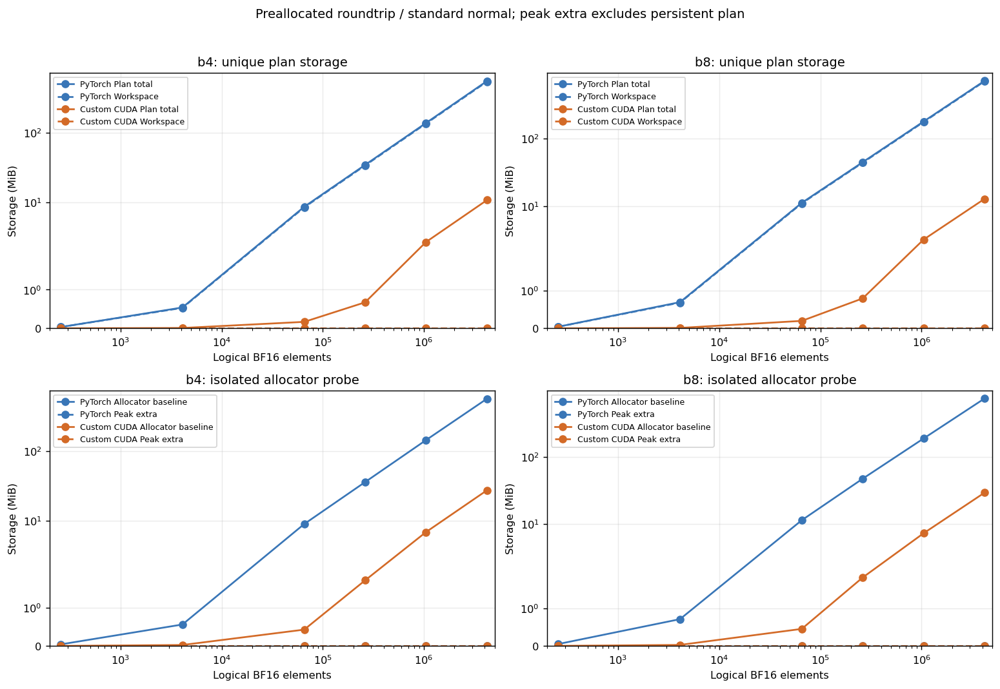

# GPU 低比特编解码实施报告

run_id：`gpu_codec_v1_20261104_001`。执行日期：2026-11-04，北京时间。技术方案版本：1.0；实施依据：[G1b 复核与执行要求](../../../reviews/gpu_codec_v1_20261101_002_review_and_g1b_plan.md)。

## 1 结论与完成范围

完成 b4/b8 **局部 codec 固定配置** 的自定义 CUDA 编码、解码和直接 5/9 位打包/解包，在同一新 run 与已验收 PyTorch 实现进行配对比较。正式正确性 2098 条记录全部通过，20800 个计时块、208 个方法汇总、1040 个显存记录及小/大输入两位宽两实现的 8 份 GPU trace 完整。执行者判断完整 G1 验收通过，提交复核；本轮止于 G1。

- N=4194304、b4 roundtrip：PyTorch 7,304.440 us，自定义 CUDA 200.428 us；五个 session 的配对比值 34.99–37.03，中位数 36.44。
- N=4194304、b8 roundtrip：PyTorch 9,251.784 us，自定义 CUDA 233.630 us；五个 session 的配对比值 38.53–41.17，中位数 39.41。
配对收益分类为 `observed`，各 case 的描述性分类计数为 `{'observed': 104}`；分类按五个 session 的四分位区间关系生成，不作显著性检验，也不把计时块视为独立训练重复。

| 项目 | 状态 | 证据 |
|---|---|---|
| 工具链与实际加载产物 | 编译/加载/真实GPU调用通过 | logs/cuda_build_a02.json；logs/cuda_build_manifest.json |
| b4/b8固定语义 | CPU码流与BF16位模式逐项通过 | correctness.jsonl |
| 真实梯度回放 | 12输入×2位宽×2GPU方法 | input_manifest.json |
| 性能/显存/trace | valid；所有记录保留 | analysis.json |
| 完整G1 | pass，待接收方复核 | summary.json |

## 2 实现与契约

冻结契约 SHA256：`3ba9895a4a22ab8d6c11f2838e9490b20d58d4fd7c5d7536129a12d9d9d51186`。CPU 参照仍为原项目 `index_repaired_bf16` 修复路径；上游 commit `96da2ee480bbfd8e2049de3fbd8595cc9d7a30b8`。CPU 原文件、LUT、阈值和 82 个夹具身份逐项记录；002 输入与原源码保持只读。旧 GPU 基线 `torch_codec.py` SHA256 固定为 `50bc272876be54db5d42327cce144022b7bf960d82073347479da2eb53f1d794`。

新实现位于 `src/gradient_comm_lab/cuda_codec.py` 与 `csrc/codec.cpp/.cu`。每个 256 元素顶层组由一个 256 线程 CTA 处理，16 元素尺度在半 warp 中归约，尺度和码值暂存在共享内存；每个输出字节有唯一线程写入。编码包含分组尺度、LUT 搜索、显式阈值舍入、尺度量化和真实紧凑打包；解码包含解包、尺度恢复和反量化。热路径每次 encode/decode 各调用一个自定义内核，roundtrip 顺序调用二者；实际次数以第 5 节 trace 为准。直接 pack/unpack 是已测试的开发模块，没有另设一个“只换打包”的主比较方法。

每一步浮点运算先以受控 FP32 执行，再在 CPU 参照规定边界舍入到 BF16；常数先取 BF16，严格 `<` 比较、整数 LUT 偏移和负零均保持。编译使用 CUDA 11.8、MSVC 19.38，实际选项 `['-O3', '--fmad=false', '--ftz=false', '--prec-div=true', '--prec-sqrt=true', '--use-local-env', '-lineinfo', '-Xptxas=-v', '-ccbin', 'E:\\dacomp\\research\\gradient_comm_lab\\.toolchains\\msvc-14.38\\VC\\Tools\\MSVC\\14.38.33130\\bin\\Hostx64\\x64']`；无 fast-math。冻结实际加载模块 `gradient_comm_lab_cuda_a02`，SHA256 `c4e37ff9394580bb15fe5d277115f616a439f2741528dff6826bc77e85f06b58`。原始命令、ninja 文件、编译器输出及 a01/a02 源码快照保留在 build/logs。

`CudaCodecPlan` 预分配 packet/output/status/epsilon；`encode_into`、`decode_into`、`roundtrip_into` 默认 trusted。三个 packet buffer 依次为低位优先 payload、uint8 scale codes、little-endian BF16 top scales，逻辑序列化与 CPU 完全一致。N 补齐至 256 倍数，编码在内核中读逻辑范围并补零，解码裁回 N；N=0 跳过原生 codec，零字节、零量化事件。

checked API 单独检查 dtype/shape/device/连续性/别名、有限性及阈值范围；内核通过显式 status word 反馈算术问题。错误索引在加载 LUT 之前限界，非法包不会先越界再依赖异常拒绝。底层 ABI 在任何模式都检查元数据与输出别名；其已登记 host `ABI_*` 错误和 CUDA 启动/非法访问/OOM 错误严格区分。使用张量设备上的 PyTorch 当前 stream 与 CUDAGuard，并记录 allocator 跨 stream 使用，延长临时 storage 生命周期。trusted 模式要求已资格验证的数值输入，不作同步数值检查。两方法 checked API 各自的检查成本属于包含分配的独立 API 测量。

## 3 正确性结果

正式记录按独立清单核对，共 2098 条：PyTorch 953 条、自定义 CUDA 981 条、CPU 参照执行 164 条，全部 pass，fail=0、skipped=0、缺失/重复=0。这个总数是检查和参照执行记录数，不是独立 GPU 实验次数。

82 输入含 36 合成、34 边界、12 真实开发梯度；每个 GPU 方法继承跨 b4/b8 的全部 117 条协议检查；每个输入/位宽另含 5 类检查。GPU 解码独立接收 CPU 产生的包；完整码流、主码、尺度码、顶层尺度和输出 BF16 位模式逐项一致，容差为零。输入/阈值/LUT 通过独立字节副本保护检查。所有 164 个 CPU 输入位宽组合与两种 GPU 方法的量化失真字段一致。

新增逐用例固定异常规则：继承的 60 个非法输入明确要求 ValueError 和精确消息；11 个底层 ABI 用例/位宽要求精确 host RuntimeError 主消息，附加 C++ 栈完整保留。意外 CUDA 错误会失败。另有非默认 stream 生产依赖、预分配及含分配临时生命周期、输出/码流 canary 边界检查。生命周期探针在 consumer 仍 pending 时释放输入与 plan，并在 producer stream 分配扰动；仅等待结果 event，不使用全设备同步。没有执行 compute-sanitizer，不将这些用例升级为工具级内存安全证明。

真实梯度来自 seed 1101、update 100/500/2500 的更新前、rank 0..3；原 FP32 长度 818048，转换次序为 FP32→BF16→BF16 除以 4→补零到 818176。未使用新训练或 holdout。

| 位宽 | 真实输入数 | 包差异字节 | 输出位差异 | 归一化平方误差范围 | 单包B |
|---|---|---|---|---|---|
| 4 | 12 | 0 | 0 | 0.00910952942–0.0107706936 | 568888 |
| 8 | 12 | 0 | 0 | 5.45335211e-05–5.99750485e-05 | 977976 |

预实验失败全部保留：a01 的 22 条失败来自 host ABI 错误消息附带栈诊断；a02 的 2 条生成器失败来自生命周期探针误拒绝已完成后合法内存复用，导致后续 4 个身份未覆盖。两处仅修正测试助手，未修改参考输出、随机阈值或数值容差。a03 预实验 2098 项通过，正式冻结后再次 2098 项通过；pytest 50/50 通过。a01→a02 native 改动为 allocator stream 生命周期记录，算术 CUDA 源码未变。详情见 `logs/correctness_development_attempts.json`、助手 diff/hash 和完整反例文件。

## 4 GPU 性能结果

主矩阵为 N=256/4096/65536/262144/1048576/4194304，两种分布、b4/b8、encode/decode/roundtrip，共 72 case；另有 8 个包含分配/checked API case 和 24 个真实梯度 roundtrip case。104 case 均对两种方法测量 5 session、每 session 20 块，逐 case/session 使用预先生成的平衡交替顺序及配对 block ID。每个 `(case_id, method_id)` 的 K 在正式测量前按固定 pilot 规则冻结，各自块时除以自身 K；同一次新 run 的 PyTorch 是收益分母。

每个 case/session 两方法独立预热并在开始前清空待执行工作；主路径预分配、trusted、eager、Graph off、steady-state reuse。输入、LUT、阈值生成和 H2D 不计入主计时，初始化成本另记。包含分配模式每次重建完整 plan，比较边界一致；checked 检查与同步只计入单列的 checked API。正式计时关闭未初始化内存调试填充，开启确定性算法，全部 workspace 写后读。

GPU CUDA event 与带边界同步的墙钟同时记录。event 区间可包含 eager 发射间隙及 API 分配/同步等待，不等于 kernel 活跃时间之和。单次延迟来自 elapsed/K；session 线性分位数与五个 session 中位数的中位数、范围分别报告，p95 是“块平均单次延迟 p95”。以下为标准正态 seed 7301；范围列为 PyTorch / CUDA 的 session 中位数范围，配对比依 session 0..4 展示。

| b | N | 操作 | PyTorch GPU us | CUDA GPU us | 墙钟 PyTorch/CUDA us | 两方法GPU session范围 us | 5个配对比 |
|---|---|---|---|---|---|---|---|
| 4 | 256 | decode | 86.451 | 9.524 | 87.808 / 9.674 | 83.880–88.223 / 9.407–9.679 | 9.19, 8.89, 9.10, 9.11, 8.87 |
| 4 | 256 | encode | 241.533 | 10.168 | 244.916 / 10.351 | 235.825–252.661 / 9.900–10.259 | 23.44, 24.40, 24.82, 24.60, 23.40 |
| 4 | 256 | roundtrip | 349.563 | 21.925 | 355.822 / 22.413 | 347.958–397.708 / 21.592–23.902 | 15.26, 16.11, 15.94, 16.64, 16.07 |
| 8 | 256 | decode | 88.941 | 9.721 | 90.288 / 9.890 | 85.479–96.458 / 9.514–10.199 | 9.15, 8.98, 9.11, 8.93, 9.46 |
| 8 | 256 | encode | 254.603 | 10.394 | 259.017 / 10.599 | 249.180–270.889 / 10.197–11.337 | 24.97, 24.21, 24.07, 23.90, 24.15 |
| 8 | 256 | roundtrip | 335.114 | 22.013 | 339.862 / 22.522 | 323.277–379.202 / 21.534–24.355 | 15.22, 15.93, 15.57, 15.43, 14.96 |
| 4 | 65536 | decode | 88.571 | 9.663 | 90.322 / 9.832 | 86.328–90.930 / 9.447–9.755 | 9.14, 9.23, 9.22, 9.17, 9.32 |
| 4 | 65536 | encode | 240.738 | 10.094 | 244.518 / 10.316 | 232.618–248.705 / 9.940–10.145 | 23.93, 23.85, 23.77, 24.52, 23.26 |
| 4 | 65536 | roundtrip | 338.553 | 21.854 | 344.819 / 22.298 | 325.480–361.836 / 21.451–22.134 | 16.56, 15.37, 15.75, 15.42, 14.79 |
| 8 | 65536 | decode | 88.465 | 9.513 | 89.839 / 9.710 | 84.319–95.983 / 9.407–9.939 | 8.92, 9.40, 9.66, 9.25, 9.12 |
| 8 | 65536 | encode | 248.645 | 10.354 | 253.016 / 10.605 | 239.484–265.660 / 10.335–10.589 | 24.02, 23.61, 24.08, 25.41, 23.17 |
| 8 | 65536 | roundtrip | 337.111 | 22.095 | 342.246 / 22.523 | 327.911–372.395 / 21.584–22.223 | 16.80, 15.45, 15.17, 15.19, 15.44 |
| 4 | 4194304 | decode | 2,671.214 | 50.108 | 2,704.960 / 51.176 | 2,448.947–2,756.555 / 46.183–50.762 | 54.32, 52.81, 54.30, 53.03, 53.03 |
| 4 | 4194304 | encode | 4,436.555 | 143.687 | 4,503.908 / 146.260 | 4,271.371–4,676.533 / 136.977–152.088 | 32.26, 28.93, 30.39, 32.55, 31.18 |
| 4 | 4194304 | roundtrip | 7,304.440 | 200.428 | 7,414.262 / 203.841 | 6,883.328–7,482.624 / 190.175–205.187 | 36.47, 36.44, 34.99, 36.19, 37.03 |
| 8 | 4194304 | decode | 2,868.297 | 51.329 | 2,932.361 / 52.174 | 2,727.714–2,922.244 / 48.404–53.091 | 55.38, 55.88, 54.54, 56.26, 58.00 |
| 8 | 4194304 | encode | 6,450.560 | 170.902 | 6,553.837 / 173.861 | 6,042.752–6,482.048 / 164.538–179.025 | 37.74, 36.14, 37.26, 36.91, 36.73 |
| 8 | 4194304 | roundtrip | 9,251.784 | 233.630 | 9,457.050 / 237.787 | 8,600.832–9,306.848 / 218.220–241.570 | 38.98, 39.64, 38.53, 41.17, 39.41 |

包含分配的 8 个 API case 单列如下，均为直接 roundtrip；两边每次创建完整 plan。checked 与 trusted 独立，不与主矩阵预分配结果混合。

| b | N | 检查模式 | PyTorch GPU us | CUDA GPU us | PyTorch wall us | CUDA wall us | 5个配对比 |
|---|---|---|---|---|---|---|---|
| 4 | 65536 | checked_api | 3,067.028 | 1,108.199 | 3,114.544 | 1,114.965 | 2.79, 2.81, 2.81, 2.68, 2.73 |
| 4 | 65536 | trusted_inputs | 810.598 | 103.723 | 822.023 | 104.541 | 8.02, 7.83, 7.70, 7.94, 8.02 |
| 8 | 65536 | checked_api | 3,068.562 | 1,113.239 | 3,110.100 | 1,121.319 | 2.76, 2.80, 2.75, 2.87, 2.78 |
| 8 | 65536 | trusted_inputs | 816.789 | 105.896 | 829.934 | 106.842 | 7.81, 7.64, 8.00, 8.01, 7.56 |
| 4 | 1048576 | checked_api | 4,012.579 | 1,146.993 | 4,077.070 | 1,156.279 | 3.50, 3.54, 3.41, 3.46, 3.44 |
| 4 | 1048576 | trusted_inputs | 1,504.512 | 144.869 | 1,541.000 | 145.756 | 10.52, 10.39, 10.11, 10.24, 10.38 |
| 8 | 1048576 | checked_api | 4,645.909 | 1,183.714 | 4,711.525 | 1,192.428 | 3.90, 3.94, 3.89, 3.79, 4.02 |
| 8 | 1048576 | trusted_inputs | 2,103.796 | 156.081 | 2,136.400 | 156.987 | 13.98, 13.04, 13.16, 13.31, 13.37 |

噪声：PyTorch 76/104、自定义 CUDA 87/104 case 至少一个 session 的 IQR/median>10%；合计 437/1040 case-session。保留全部数据，不据此剔除。torch_cuda_repaired 最大 session_median_max_over_min=1.285，对应 `synthetic_standard_normal_seed7301_n4096__b4__encode__preallocated__trusted_inputs`。cuda_optimized_repaired 最大 session_median_max_over_min=1.312，对应 `synthetic_standard_normal_seed7301_n4096__b4__decode__preallocated__trusted_inputs`。 会话内 noise_flag=false 不等于跨会话稳定。pilot 规则、K、时钟/负载/WDDM 快照、块长偏离和全部墙钟值见 config/raw/analysis；块长诊断为 `{"target_block_ms": [10, 50], "block_count": 20800, "elapsed_ms_min": 12.67404842376709, "elapsed_ms_median": 21.408623695373535, "elapsed_ms_max": 76.10050964355469, "below_target_count": 0, "above_target_count": 9, "interpretation": "Target-range misses are quality diagnostics only. K stays frozen and all valid observations are retained."}`。

收益分类由各 session 的四分位区间分离情况描述；差异不足以覆盖波动的 case 标为 inconclusive。不得只挑最大加速比，也不对不同输入/API 边界合并成一个“整体加速”。图表可由 `scripts/summarize_g1b.py` 重建：

## 5 字节、显存与性能剖析

对补齐长度 L，完整 wire bytes=`ceil(L*(b+1)/8)+L/16+2*L/256`；b4/b8 实际存储 5/9 位主码。L=256 时分别 160+16+2=178 B、288+16+2=306 B，即 5.5625/9.5625 bits/element。尾块按真实逻辑 N 作有效位数分母，padding 已包含在 payload/scale 中，不另加第二份 padding。roundtrip 的 wire 大小指一个包，不代表网络传输。

下表为 N=4194304、标准正态、预分配 roundtrip，5 个 session 显存独立测量中位数（单位 B）。workspace 包含唯一 storage，views 不重复计数；原 PyTorch 的 O(N) int64 索引/临时 word/算术数组被 CUDA 寄存器/共享内存局部计算取代。

| b | 方法 | 输入 | 阈值 | LUT | 包 | 输出 | workspace | peak extra allocated | 列示device张量总计 |
|---|---|---|---|---|---|---|---|---|---|
| 4 | torch_cuda_repaired | 8388608 | 8912896 | 66 | 2916352 | 8388608 | 569114654 | 0 | 597721184 |
| 4 | cuda_optimized_repaired | 8388608 | 8912896 | 66 | 2916352 | 8388608 | 6 | 0 | 28606536 |
| 8 | torch_cuda_repaired | 8388608 | 8912896 | 1026 | 5013504 | 8388608 | 736886814 | 0 | 767591456 |
| 8 | cuda_optimized_repaired | 8388608 | 8912896 | 1026 | 5013504 | 8388608 | 6 | 0 | 30704648 |

allocator allocated/reserved 与唯一张量存储组成分别记录。预分配基线已包括整个 plan，所以 peak extra=0 也不代表没有工作内存；寄存器/CTA共享内存和驱动内部资源不计入 PyTorch tensor storage。ptxas 编译记录显示 encode 每CTA共享内存 580 B，b4/b8 分别每线程 30/29 个寄存器，decode 为 16 个寄存器，无 spill；这些是编译资源记录，不与全局张量 workspace 相加。配对计时同时驻留两套各自相同输入与 plan，可能影响缓存及显存压力；独立显存探针只持有当前方法，故其 allocator 基线不是配对计时时总占用。CUDA workspace 包含持久 status 和 epsilon，不宣称零工作区。详细 allocated/reserved、峰值、输入/阈值/LUT/包/输出与总 storage 见 `memory.jsonl`。

分别剖析 N=65536 和 4194304、b4/b8、两种方法，每份三次 roundtrip。GPU 活动来源为项目局部 CUPTI 12.9 collector，运行中的 PyTorch CUDA runtime 仍为 11.8。原始活动、Chrome 窗口、external correlation 和审计日志逐项对应，所有 trace 必须无丢记录、无采集错误、所有 kernel 归属明确才进入以下统计。profiler 时间不作为正式延迟样本。

| 方法 | b | N | 每次kernel数 | 3次kernel总数 | copy方向次数 | copy总B | manifest |
|---|---|---|---|---|---|---|---|
| torch_cuda_repaired | 4 | 65536 | {'0': 52, '1': 52, '2': 52} | 156 | {"DtoD": 6} | 1966080 | traces/gpu_activity_manifest_t4sa01.json |
| torch_cuda_repaired | 4 | 4194304 | {'0': 52, '1': 52, '2': 52} | 156 | {"DtoD": 6} | 125829120 | traces/gpu_activity_manifest_t4la01.json |
| torch_cuda_repaired | 8 | 65536 | {'0': 52, '1': 52, '2': 52} | 156 | {"DtoD": 6} | 1966080 | traces/gpu_activity_manifest_t8sa01.json |
| torch_cuda_repaired | 8 | 4194304 | {'0': 52, '1': 52, '2': 52} | 156 | {"DtoD": 6} | 125829120 | traces/gpu_activity_manifest_t8la01.json |
| cuda_optimized_repaired | 4 | 65536 | {'0': 2, '1': 2, '2': 2} | 6 | {} | 0 | traces/gpu_activity_manifest_c4sa01.json |
| cuda_optimized_repaired | 4 | 4194304 | {'0': 2, '1': 2, '2': 2} | 6 | {} | 0 | traces/gpu_activity_manifest_c4la01.json |
| cuda_optimized_repaired | 8 | 65536 | {'0': 2, '1': 2, '2': 2} | 6 | {} | 0 | traces/gpu_activity_manifest_c8sa01.json |
| cuda_optimized_repaired | 8 | 4194304 | {'0': 2, '1': 2, '2': 2} | 6 | {} | 0 | traces/gpu_activity_manifest_c8la01.json |

源码和显存测量确认减少了全局中间张量；两个长度的实际 trace 用于核对内核调用及复制活动变化，延迟收益来自第 4 节的独立配对测量。本 collector 未测 DRAM 事务量，不能仅凭内核次数断言大输入的唯一瓶颈，也不能将输入等效 GB/s 解释为 DRAM 带宽或网络吞吐。无主机传输的判断只覆盖已明确划定的三次调用窗口，初始化/H2D 在窗口外。

## 6 未解决问题与下一步

| 问题 | 影响 | 证据 | 建议 |
|---|---|---|---|
| WDDM桌面噪声及跨session漂移 | 小收益可能不确定，所有样本保留 | raw/summary/analysis | 按全session配对比及波动解释，需要复测则建新run |
| 外部夹具与本机工具链依赖 | 小ZIP不是跨机器独立环境 | fixtures_manifest/REPRODUCE | 按清单取得外部文件；不改历史目录 |
| 旧供应catalog/channel不一致记录 | 不能声明完整供应链全部验证 | environment与002工具链日志 | 沿用明确边界，不影响已核验的本地模块调用 |

建议 `review_required`：复核完整 G1 证据后再决定 G2。后续若进入 G2，应单独恢复跨 worker 聚合、随机状态及训练更新语义；这些未在本轮实现。没有“必须快多少”的验收门槛，当前收益只对本机和实测实现比较成立。

## 7 复现与结论边界

[REPRODUCE.md](REPRODUCE.md) 提供实际执行命令及日志。完整目录：`E:/dacomp/research/gradient_comm_lab/results/gpu_codec_v1/gpu_codec_v1_20261104_001`。源码清单、夹具外部路径与 SHA256、编译产物身份及原始 trace 均保留；小型 ZIP 可排除编译缓存和外部大夹具，但应带明确清单。

本轮证明指定 GPU、输入、固定数值契约下局部 codec 的逐位正确性和成本。它不是完整 DynamiQ GPU 复现、先进 codec 优越性证明、AllReduce 加速或大模型训练加速；新训练质量、多 GPU 网络吞吐和训练加速字段仍为 false。旧训练结果未纳入本轮新增验证。

## 8 交付文件核对

- [x] summary、环境、冻结契约、基准配置填写完整，template_only=false。
- [x] CPU/GPU源码、实际编译模块、测试、配置、输入与夹具身份可核验。
- [x] 正确性清单、20800计时块、208汇总、1040显存与配对关系完整。
- [x] 5张图从原始记录生成；8组小/大输入GPUtrace及原始活动审计完整。
- [x] 实际复现命令、构建日志、失败尝试、测试助手改动及原始反例保留。
- [x] G2及以上未执行，结果边界和开放问题已明确。最终封存完整性与ZIP核对由独立seal/package脚本生成。
